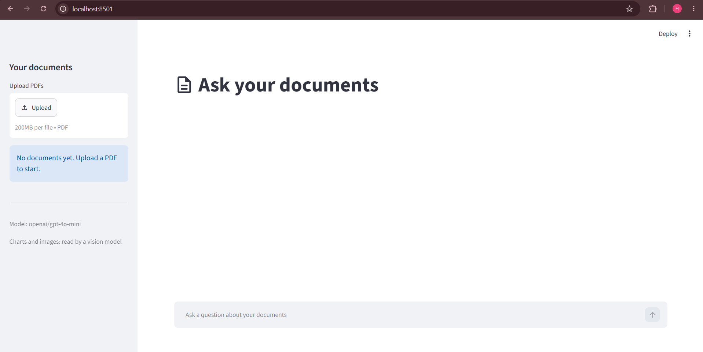
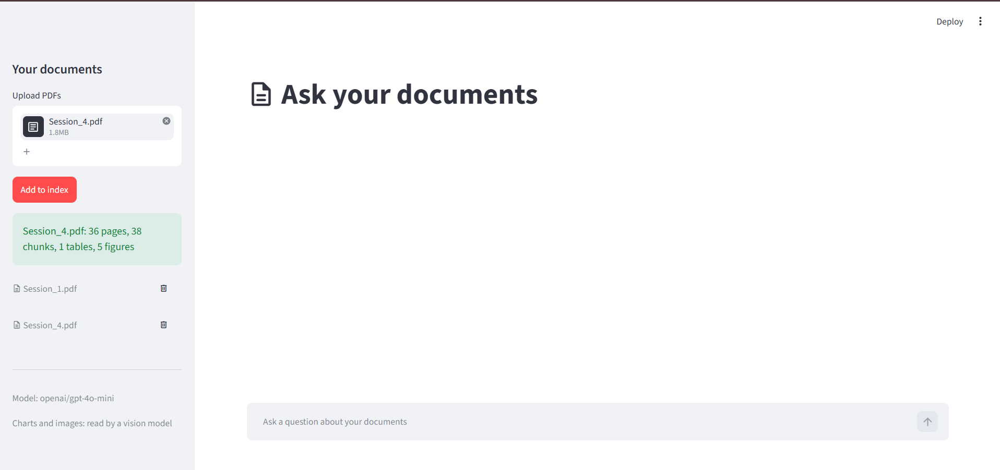
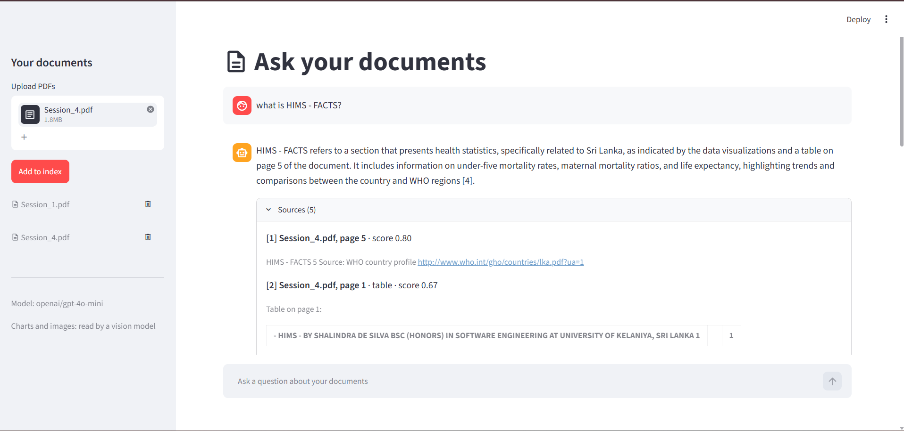

# 📄 Smart Document Q&A

> Upload PDFs, ask questions in plain English, and get answers with **exact page citations**, including answers that come from **tables, charts and photos**.


---

## 📖 Project Overview

**Smart Document Q&A** is a Retrieval-Augmented Generation (RAG) application. You upload one or more PDFs, and the app:

1. **Reads** each PDF page by page: text, tables, and pages that contain images or charts.
2. **Indexes** everything in a local vector database, using embeddings computed on your own machine.
3. **Answers** your questions by finding the most relevant passages and asking a language model to answer **using only those passages**, citing them as `[1]`, `[2]`, … with the file name and page number.

If the documents don't contain the answer, the app says so instead of guessing.

---

## ✨ Key Features

- **Multimodal understanding**
  - **Text**: cleaned page text, split into overlapping chunks.
  - **Tables**: detected with `pdfplumber` and converted to Markdown so rows and columns stay searchable.
  - **Images & charts**: figures are cut out of the page with **SAM (MobileSAM)**, logos and decorative images are dropped, and a **vision model captions** the rest. The caption is indexed like any other text, so you can ask "what does the chart on page 7 show?". The cropped picture is saved too.
- **Image-aware answers**: for each question the app decides whether a figure would help (a similarity filter, then a small LLM judge). Only useful figures are sent to the model together with the text and shown under the answer. Most questions get no image.
- **Conversation memory**: chats are saved (SQLite) and listed in the sidebar. A follow-up such as "what about part-time staff?" is rewritten into a standalone question before searching, and recent turns go into the answer prompt.
- **Voice assistant**: tap the microphone in the chat bar, ask your question aloud, and the answer is shown and **read back to you**. With a Gemini key, **Gemini** hears and speaks (nothing extra to install). Without one, speech recognition (**faster-whisper**) and speech output (**Piper**, with the system voice as a fallback) run locally on your machine. Any answer can also be played later with its **Listen** button. Details are in the *Voice assistant* section below.
- **Exact citations**: every answer links back to `file, page`, with the cited sources highlighted and tagged as text, table or figure.
- **Vector search with similarity scores**: results are ranked by cosine similarity, and weak matches below a threshold are dropped.
- **Strict hallucination prevention**: the model is told to answer only from the retrieved sources and to reply *"I couldn't find that in the documents."* otherwise. If nothing relevant is retrieved, the model isn't called at all.
- **Search-only fallback mode**: with no API key, the app still works as a semantic search engine and shows the most relevant passages.
- **Resilient API calls**: temporary errors (429/5xx, timeouts) are retried with backoff, with an optional fallback model.
- **Cost-aware ingestion**: re-uploading the same PDF is a no-op, and figures that are already captioned are not sent to the vision model again.
- **Web UI and CLI**: a Streamlit chat interface, plus a command-line tool for scripting.
- **Evaluation script**: measures retrieval quality (hit@1, hit@k, MRR) so chunking settings can be tuned with data, not guesswork.

---

## 🛠️ Technologies Used

| Area | Technology |
|---|---|
| **Core language** | Python 3.11+ |
| **PDF & multimodal parsing** | [`pypdf`](https://pypi.org/project/pypdf/) (text), [`pdfplumber`](https://pypi.org/project/pdfplumber/) (tables, image/chart detection), [`pypdfium2`](https://pypi.org/project/pypdfium2/) (page rendering) |
| **Embeddings** | [`fastembed`](https://pypi.org/project/fastembed/) running **locally on CPU** with `BAAI/bge-small-en-v1.5` (no GPU, no API key) |
| **Image segmentation** | [`ultralytics`](https://docs.ultralytics.com/models/mobile-sam/) with **MobileSAM** (needs PyTorch), run locally on CPU |
| **Chat memory** | `sqlite3` from the standard library |
| **Vector database** | [`chromadb`](https://www.trychroma.com/): embedded, persistent, cosine similarity |
| **LLM / vision** | **[Google Gemini](https://ai.google.dev/)** through its OpenAI-compatible endpoint, or [OpenRouter](https://openrouter.ai/) (many models, one key). Both use the standard `openai` SDK |
| **Voice** | Gemini speech models, or local and optional: [`faster-whisper`](https://pypi.org/project/faster-whisper/) (speech to text) and [`piper-tts`](https://pypi.org/project/piper-tts/) / [`pyttsx3`](https://pypi.org/project/pyttsx3/) (text to speech) |
| **Web UI** | [Streamlit](https://streamlit.io/) |
| **Testing** | `pytest`, with fakes for the embedder, LLM and vision model |

**Architecture style:** small modules with clear responsibilities, wired together in one place with **dependency injection** (`build_app()`), and `Protocol`s for the embedder, generator and vision describer so each can be swapped or faked in tests.

---

## 🗄️ Database Architecture

### How ChromaDB runs locally

Chroma runs **embedded inside the Python process**: there is no server to install. It stores everything in a folder (`data/chroma/`, a SQLite file plus vector index files), so the index **persists between runs**. Vectors use **cosine distance**, and the app reports a similarity score of `1 − distance`.

Each stored chunk has:

| Field | Meaning |
|---|---|
| `id` | Stable id, e.g. `3f9a1c2b7d10-p2-c0` (text), `…-p2-t0` (table), `…-p3-f0` (figure) |
| `document` | The chunk text (or Markdown table, or image caption) |
| `embedding` | 384-dim vector from `bge-small-en-v1.5` |
| `metadata` | `source` (file name), `page`, `doc_id`, `kind` (`text` / `table` / `figure`) |

### Chunking with overlap

Pages are split into chunks of about **500 characters with 100 characters of overlap**, so a sentence cut at a boundary still appears whole in the next chunk. Chunks **never cross a page boundary**, which guarantees every citation maps to exactly one page. Long tables are split by rows, with the header row repeated in each part.

### Document fingerprinting (idempotence)

Each PDF gets a `doc_id`: the first 12 characters of the **SHA-256 hash of the file's bytes**, independent of the file name. Chunk ids are built from that fingerprint plus page and position, and chunks are written with `upsert`. So:

- Uploading the **same PDF twice does not create duplicates**.
- Renaming a file doesn't change its identity.
- Deleting a document removes all of its chunks by `doc_id`.

```
PDF ──► pypdf text ───────► chunker ──┐
    ├─► pdfplumber tables ─► Markdown ─┼─► local embeddings ─► Chroma
    └─► pypdfium2 render ──► vision ───┘        (fastembed)    (persistent)
                              caption

Question ─► embed ─► Chroma top-k ─► filter by score ─► LLM (sources only) ─► answer + citations
```

---

## 🔑 API Key Setup

The app answers with **Google Gemini** (or OpenRouter). Create a Gemini key at [aistudio.google.com/apikey](https://aistudio.google.com/apikey), then create a `.env` file in the project root (copy `.env.example`):

```env
GEMINI_API_KEY=your-gemini-api-key

# Optional settings (these are the defaults)
# GEMINI_MODEL=gemini-3.8-flash         # answers, rewriting, image judging, figure captions
# GEMINI_FALLBACK_MODEL=                # optional: tried if the main model is busy
# VISION_PROVIDER=auto                  # auto | none
# VISION_MODEL=                         # defaults to GEMINI_MODEL; must accept images
# TOP_K=5                               # passages sent to the model
# MIN_SCORE=0.5                         # minimum similarity to count as relevant
# DATA_DIR=./data
# SEGMENTER=sam                         # sam | none
# IMAGE_MIN_SCORE=0.45                  # caption similarity needed to consider a figure
# MAX_IMAGES=2                          # most figures sent with one question
# HELPER_MODEL=                         # small model for follow-up rewriting and image judging
# MEMORY_MESSAGES=6                     # earlier messages used to understand follow-ups

# Voice settings (VOICE_STT, WHISPER_MODEL, VOICE_TTS, PIPER_VOICE, ...) are listed in .env.example
```

- **Which provider answers:** `LLM_PROVIDER=auto` (the default) uses Gemini when `GEMINI_API_KEY` is set, otherwise OpenRouter. Set `LLM_PROVIDER=openrouter` to keep using OpenRouter even when a Gemini key is present.
- **Using OpenRouter instead:** set `OPENROUTER_API_KEY` (and optionally `OPENROUTER_MODEL`, `OPENROUTER_FALLBACK_MODEL`) from [openrouter.ai/keys](https://openrouter.ai/keys). Model ids differ between providers (`gemini-3.8-flash` for Gemini, `google/gemini-2.5-flash` or `openai/gpt-4o-mini` for OpenRouter), and `VISION_MODEL` / `HELPER_MODEL` must match the provider that answers.
- **Voice with the same key:** a Gemini key also switches voice to Gemini (see *Voice assistant* below).
- **No key?** The app starts in **search-only mode**.
- **Charts and photos** need a vision-capable model. Set `VISION_PROVIDER=none` to skip captioning (tables and text still work).
- `.env` is in `.gitignore`. **Never commit your key.**

---

## 🚀 How to Run

### 1. Clone and create a virtual environment

```bash
git clone https://github.com/<your-username>/A-Smart-Document-Q-A-.git
cd A-Smart-Document-Q-A-

python -m venv .venv

# Windows (PowerShell)
.venv\Scripts\Activate.ps1
# macOS / Linux
source .venv/bin/activate
```

### 2. Install dependencies

SAM needs PyTorch. Install the **CPU build first**: it is far smaller than the default (CUDA) download.

```bash
pip install torch torchvision --index-url https://download.pytorch.org/whl/cpu
pip install -r requirements.txt
```

The MobileSAM weights (~40 MB) download on first use into `data/models/`. If PyTorch or `ultralytics` is missing, or `SEGMENTER=none`, the app still works and crops figures from the boxes `pdfplumber` finds.

#### Optional: voice assistant

```bash
pip install -r requirements-voice.txt
python scripts/download_voice_models.py     # Whisper 'base' (~140 MB) and a Piper voice (~60 MB), once
```

These are only needed for the **local** voice engines. With a Gemini key, voice uses Gemini and nothing here is required. Without a key and without these packages, the app works as before and the sidebar says that voice is off.

### 3. Add your API key

```bash
copy .env.example .env      # Windows   (macOS/Linux: cp .env.example .env)
# then edit .env and set GEMINI_API_KEY (or OPENROUTER_API_KEY)
```

### 4. Start the web app

```bash
streamlit run app.py
```

Open <http://localhost:8501>, upload PDFs in the sidebar, click **Add to index**, and start asking questions. The first run downloads the ~65 MB embedding model.

To ask by voice, click the **microphone** in the chat bar, speak, and send. The browser only allows microphone access on `http://localhost` or HTTPS, and asks for permission the first time.

### Or use the command line

```bash
python cli.py ingest sample_docs/employee_handbook.pdf
python cli.py ask "How many days of annual leave do I get?"
python cli.py chat          # a conversation with memory; type exit to stop
python cli.py docs
```

### Generate the sample document

```bash
python scripts/make_sample_pdf.py            # creates sample_docs/employee_handbook.pdf (text only)
python scripts/make_sample_report_pdf.py     # creates sample_docs/nimbus_annual_report.pdf (charts, table, diagram, logo)
```

### Run the tests and the retrieval evaluation

```bash
python -m pytest tests -o python_files="*.py"            # all tests
python -m pytest tests -o python_files="*.py" -m "not slow"   # skip tests that load the real embedding model
python eval/evaluate.py                                   # hit@1, hit@k, MRR on the sample handbook
```

---

## 🎙️ Voice assistant

Ask a question aloud and hear the answer:

1. **Ask**: click the microphone in the chat bar, speak, and send. Your recording is turned into text by Gemini, or on your machine with faster-whisper. The text appears in the chat, marked as a spoken question, so you can see what was heard.
2. **Answer**: the question goes through the same pipeline as a typed one: follow-up rewriting, retrieval, citations and sources.
3. **Listen**: the answer is read aloud (Gemini or Piper) without citation markers like `[1]` or Markdown symbols. Very long answers are shortened when spoken and end with "See the full answer on screen."

Typed questions are not read aloud, but every answer has a **Listen** button. If speech output fails, the written answer is still shown.

| Variable | Default | Purpose |
|---|---|---|
| `VOICE_STT` | `gemini` with a Gemini key, else `whisper` | `gemini`, `whisper` or `none` (hides the microphone) |
| `WHISPER_MODEL` | `base` | `tiny`, `base`, `small`, ... Larger models understand more but are slower |
| `VOICE_LANGUAGE` | empty | Force a language such as `en`; empty detects it |
| `VOICE_TTS` | `gemini` with a Gemini key, else `piper` | `gemini`, `piper`, `pyttsx3` (the operating system's voice) or `none` |
| `GEMINI_STT_MODEL` / `GEMINI_TTS_MODEL` | `gemini-3.8-flash` / `gemini-3.8-flash-tts` | Gemini models for hearing and speaking |
| `GEMINI_VOICE` | `Kore` | Gemini voice name (`Puck`, `Charon`, ... ) |
| `PIPER_VOICE` | `data/models/piper/en_US-lessac-medium.onnx` | Voice file. Other languages need a matching voice |
| `VOICE_AUTOPLAY` | `true` | Start playing a spoken answer right away |

You can mix the two: for example `VOICE_STT=whisper` to hear locally while Gemini speaks. If `VOICE_STT` or `VOICE_TTS` is `gemini` but there is no `GEMINI_API_KEY`, the local engines are used instead. Gemini voice sends the recording and the answer text to Google and needs internet; the local engines keep everything on your machine. Local speed on a laptop CPU: about 1 to 2 seconds to transcribe a short question, well under a second to speak the answer.

---

## 📁 Project Structure

```
├── app.py                  # Streamlit chat UI
├── cli.py                  # Command-line interface
├── rag/
│   ├── config.py           # Settings + build_app() (the one place objects are wired)
│   ├── pdf_loader.py       # PDF → clean text, page by page
│   ├── chunker.py          # Overlapping chunks that respect page boundaries
│   ├── multimodal.py       # Tables → Markdown, pages → images → captions
│   ├── vision.py           # VisionDescriber protocol + OpenRouter implementation
│   ├── embeddings.py       # Local fastembed embedder
│   ├── vector_store.py     # Chroma wrapper
│   ├── generator.py        # Prompt building + LLM call + citation parsing
│   ├── gemini.py           # Gemini client (OpenAI-compatible endpoint)
│   ├── openrouter.py       # OpenRouter client, retry and fallback
│   ├── voice.py            # Speech to text (Whisper) and text to speech (Piper, pyttsx3)
│   ├── pipeline.py         # DocQA: ingest PDFs and answer questions
│   └── models.py           # Dataclasses: Page, Chunk, SearchResult, Answer
├── eval/                   # Retrieval-quality evaluation
├── requirements-voice.txt  # Optional packages for the local voice engines
├── scripts/                # Sample PDF generators, voice model download
├── sample_docs/            # Example PDFs: a text handbook and an annual report with charts
└── tests/                  # pytest suite with fakes (no network needed)
```

---

## 🖼️ Screenshots

> Add your screenshots to `docs/screenshots/` using the file names below.

**Streamlit UI**



**Uploaded documents in the sidebar**



**Chat answer with sources and page citations**



---

## 🎓 Learning Outcomes

Building this project teaches a software engineering undergraduate how to:

- Design an end-to-end **RAG pipeline**: ingest, chunk, embed, retrieve, generate, cite.
- Understand **vector embeddings** and measure semantic closeness with **cosine similarity**.
- Use a **vector database** (Chroma) with metadata, persistence and idempotent upserts.
- Tune **chunk size and overlap**, and judge the effect with retrieval metrics (**hit@k, MRR**).
- Reduce **LLM hallucination** with grounded prompts, relevance thresholds and "not found" behaviour.
- Apply **multimodal chunking**: turn tables into Markdown and charts or photos into searchable captions with a vision model.
- Write maintainable code with **dependency injection**, **protocols** and **dataclasses**.
- Build **resilient API integrations**: retries with backoff, fallback models, and clear error messages.
- Write fast, reliable **automated tests** using fakes and mocks, with no network or paid API calls.
- Handle real-world issues such as **Windows file locking** and caching in a Streamlit app.

---

## 👩‍💻 Author

**H.G. Hansi Tharaki**
Software Engineering Undergraduate, University of Kelaniya

