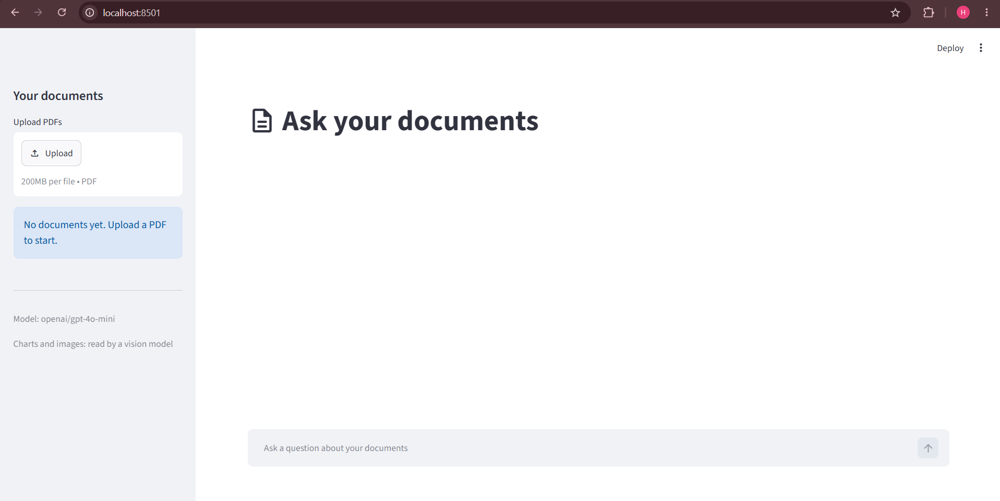
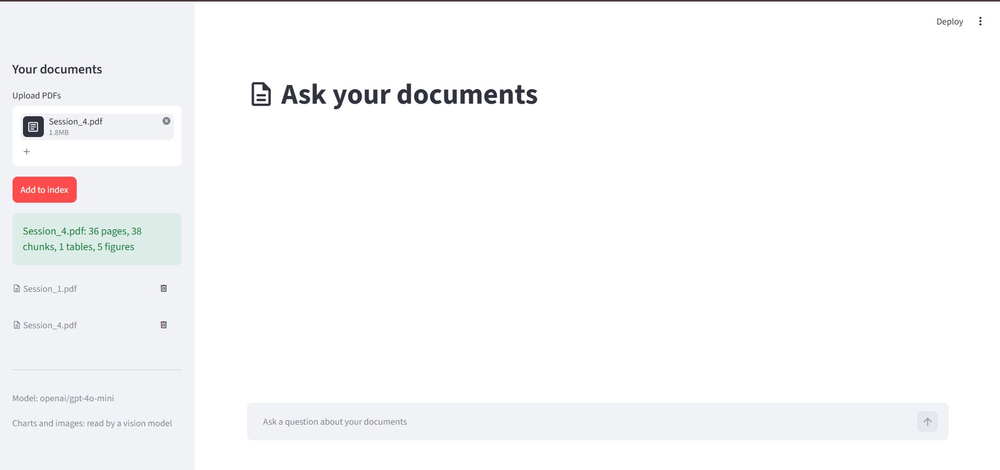
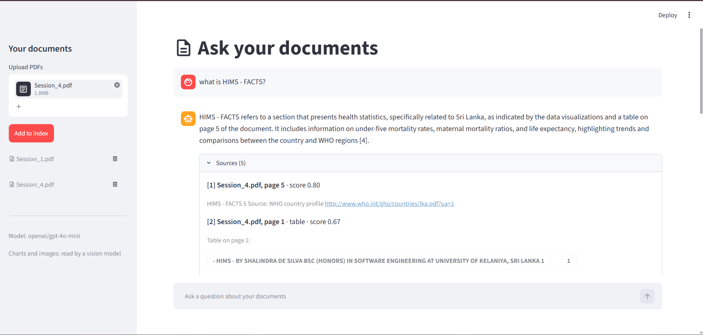

# 📄 Smart Document Q&A

> Upload PDFs, ask questions in plain English, and get answers with **exact page citations**, including answers that come from **tables, charts and photos**.


---

## 📖 Project Overview

**Smart Document Q&A** is a Retrieval-Augmented Generation (RAG) application. You upload one or more PDFs, and the app:

1. **Reads** each PDF page by page: text, tables, and pages that contain images or charts.
2. **Indexes** everything in a local vector database, using embeddings computed on your own machine.
3. **Answers** your questions by finding the most relevant passages and asking a language model to answer **using only those passages**, citing them as `[1]`, `[2]`, … with the file name and page number.

If the documents don't contain the answer, the app says so instead of guessing.

---

## ✨ Key Features

- **Multimodal understanding**
  - **Text**: cleaned page text, split into overlapping chunks.
  - **Tables**: detected with `pdfplumber` and converted to Markdown so rows and columns stay searchable.
  - **Images & charts**: pages with photos or charts are rendered to images and **captioned by a vision model**. The caption is indexed like any other text, so you can ask "what does the chart on page 7 show?".
- **Exact citations**: every answer links back to `file, page`, with the cited sources highlighted and tagged as text, table or figure.
- **Vector search with similarity scores**: results are ranked by cosine similarity, and weak matches below a threshold are dropped.
- **Strict hallucination prevention**: the model is told to answer only from the retrieved sources and to reply *"I couldn't find that in the documents."* otherwise. If nothing relevant is retrieved, the model isn't called at all.
- **Search-only fallback mode**: with no API key, the app still works as a semantic search engine and shows the most relevant passages.
- **Resilient API calls**: temporary errors (429/5xx, timeouts) are retried with backoff, with an optional fallback model.
- **Cost-aware ingestion**: re-uploading the same PDF is a no-op, and figures that are already captioned are not sent to the vision model again.
- **Web UI and CLI**: a Streamlit chat interface, plus a command-line tool for scripting.
- **Evaluation script**: measures retrieval quality (hit@1, hit@k, MRR) so chunking settings can be tuned with data, not guesswork.

---

## 🛠️ Technologies Used

| Area | Technology |
|---|---|
| **Core language** | Python 3.11+ |
| **PDF & multimodal parsing** | [`pypdf`](https://pypi.org/project/pypdf/) (text), [`pdfplumber`](https://pypi.org/project/pdfplumber/) (tables, image/chart detection), [`pypdfium2`](https://pypi.org/project/pypdfium2/) (page rendering) |
| **Embeddings** | [`fastembed`](https://pypi.org/project/fastembed/) running **locally on CPU** with `BAAI/bge-small-en-v1.5` (no GPU, no API key) |
| **Vector database** | [`chromadb`](https://www.trychroma.com/): embedded, persistent, cosine similarity |
| **LLM / vision** | [OpenRouter](https://openrouter.ai/) through the standard `openai` SDK. OpenRouter gives access to many models (OpenAI, Google Gemini, Anthropic Claude, …) with one key |
| **Web UI** | [Streamlit](https://streamlit.io/) |
| **Testing** | `pytest`, with fakes for the embedder, LLM and vision model |

**Architecture style:** small modules with clear responsibilities, wired together in one place with **dependency injection** (`build_app()`), and `Protocol`s for the embedder, generator and vision describer so each can be swapped or faked in tests.

---

## 🗄️ Database Architecture

### How ChromaDB runs locally

Chroma runs **embedded inside the Python process**: there is no server to install. It stores everything in a folder (`data/chroma/`, a SQLite file plus vector index files), so the index **persists between runs**. Vectors use **cosine distance**, and the app reports a similarity score of `1 − distance`.

Each stored chunk has:

| Field | Meaning |
|---|---|
| `id` | Stable id, e.g. `3f9a1c2b7d10-p2-c0` (text), `…-p2-t0` (table), `…-p3-f0` (figure) |
| `document` | The chunk text (or Markdown table, or image caption) |
| `embedding` | 384-dim vector from `bge-small-en-v1.5` |
| `metadata` | `source` (file name), `page`, `doc_id`, `kind` (`text` / `table` / `figure`) |

### Chunking with overlap

Pages are split into chunks of about **500 characters with 100 characters of overlap**, so a sentence cut at a boundary still appears whole in the next chunk. Chunks **never cross a page boundary**, which guarantees every citation maps to exactly one page. Long tables are split by rows, with the header row repeated in each part.

### Document fingerprinting (idempotence)

Each PDF gets a `doc_id`: the first 12 characters of the **SHA-256 hash of the file's bytes**, independent of the file name. Chunk ids are built from that fingerprint plus page and position, and chunks are written with `upsert`. So:

- Uploading the **same PDF twice does not create duplicates**.
- Renaming a file doesn't change its identity.
- Deleting a document removes all of its chunks by `doc_id`.

```
PDF ──► pypdf text ───────► chunker ──┐
    ├─► pdfplumber tables ─► Markdown ─┼─► local embeddings ─► Chroma
    └─► pypdfium2 render ──► vision ───┘        (fastembed)    (persistent)
                              caption

Question ─► embed ─► Chroma top-k ─► filter by score ─► LLM (sources only) ─► answer + citations
```

---

## 🔑 API Key Setup

The app uses **OpenRouter**. Create a key at [openrouter.ai/keys](https://openrouter.ai/keys), then create a `.env` file in the project root (copy `.env.example`):

```env
OPENROUTER_API_KEY=your-openrouter-api-key

# Optional settings (these are the defaults)
# OPENROUTER_MODEL=openai/gpt-4o-mini
# OPENROUTER_FALLBACK_MODEL=            # optional: tried if the main model is overloaded
# VISION_PROVIDER=openrouter            # openrouter | none
# VISION_MODEL=                         # defaults to OPENROUTER_MODEL; must accept images
# TOP_K=5                               # passages sent to the model
# MIN_SCORE=0.5                         # minimum similarity to count as relevant
# DATA_DIR=./data
```

- **Using Gemini or Claude:** set `OPENROUTER_MODEL` to an OpenRouter model id, such as `google/gemini-2.5-flash` or an Anthropic model id from [openrouter.ai/models](https://openrouter.ai/models). A direct `GEMINI_API_KEY` or `ANTHROPIC_API_KEY` is **not** used.
- **No key?** The app starts in **search-only mode**.
- **Charts and photos** need a vision-capable model. Set `VISION_PROVIDER=none` to skip captioning (tables and text still work).
- `.env` is in `.gitignore`. **Never commit your key.**

---

## 🚀 How to Run

### 1. Clone and create a virtual environment

```bash
git clone https://github.com/<your-username>/A-Smart-Document-Q-A-.git
cd A-Smart-Document-Q-A-

python -m venv .venv

# Windows (PowerShell)
.venv\Scripts\Activate.ps1
# macOS / Linux
source .venv/bin/activate
```

### 2. Install dependencies

```bash
pip install -r requirements.txt
```

### 3. Add your API key

```bash
copy .env.example .env      # Windows   (macOS/Linux: cp .env.example .env)
# then edit .env and set OPENROUTER_API_KEY
```

### 4. Start the web app

```bash
streamlit run app.py
```

Open <http://localhost:8501>, upload PDFs in the sidebar, click **Add to index**, and start asking questions. The first run downloads the ~65 MB embedding model.

### Or use the command line

```bash
python cli.py ingest sample_docs/employee_handbook.pdf
python cli.py ask "How many days of annual leave do I get?"
python cli.py docs
```

### Generate the sample document

```bash
python scripts/make_sample_pdf.py     # creates sample_docs/employee_handbook.pdf
```

### Run the tests and the retrieval evaluation

```bash
python -m pytest tests -o python_files="*.py"            # all tests
python -m pytest tests -o python_files="*.py" -m "not slow"   # skip tests that load the real embedding model
python eval/evaluate.py                                   # hit@1, hit@k, MRR on the sample handbook
```

---

## 📁 Project Structure

```
├── app.py                  # Streamlit chat UI
├── cli.py                  # Command-line interface
├── rag/
│   ├── config.py           # Settings + build_app() (the one place objects are wired)
│   ├── pdf_loader.py       # PDF → clean text, page by page
│   ├── chunker.py          # Overlapping chunks that respect page boundaries
│   ├── multimodal.py       # Tables → Markdown, pages → images → captions
│   ├── vision.py           # VisionDescriber protocol + OpenRouter implementation
│   ├── embeddings.py       # Local fastembed embedder
│   ├── vector_store.py     # Chroma wrapper
│   ├── generator.py        # Prompt building + LLM call + citation parsing
│   ├── openrouter.py       # OpenAI-SDK client, retry and fallback
│   ├── pipeline.py         # DocQA: ingest PDFs and answer questions
│   └── models.py           # Dataclasses: Page, Chunk, SearchResult, Answer
├── eval/                   # Retrieval-quality evaluation
├── scripts/                # Sample PDF generator
├── sample_docs/            # Example PDF
└── tests/                  # pytest suite with fakes (no network needed)
```

---

## 🖼️ Screenshots

> Add your screenshots to `docs/screenshots/` using the file names below.

**Streamlit UI**



**Uploaded documents in the sidebar**



**Chat answer with sources and page citations**



---

## 🎓 Learning Outcomes

Building this project teaches a software engineering undergraduate how to:

- Design an end-to-end **RAG pipeline**: ingest, chunk, embed, retrieve, generate, cite.
- Understand **vector embeddings** and measure semantic closeness with **cosine similarity**.
- Use a **vector database** (Chroma) with metadata, persistence and idempotent upserts.
- Tune **chunk size and overlap**, and judge the effect with retrieval metrics (**hit@k, MRR**).
- Reduce **LLM hallucination** with grounded prompts, relevance thresholds and "not found" behaviour.
- Apply **multimodal chunking**: turn tables into Markdown and charts or photos into searchable captions with a vision model.
- Write maintainable code with **dependency injection**, **protocols** and **dataclasses**.
- Build **resilient API integrations**: retries with backoff, fallback models, and clear error messages.
- Write fast, reliable **automated tests** using fakes and mocks, with no network or paid API calls.
- Handle real-world issues such as **Windows file locking** and caching in a Streamlit app.

---

## 👩‍💻 Author

**H.G. Hansi Tharaki**
Software Engineering Undergraduate, University of Kelaniya

